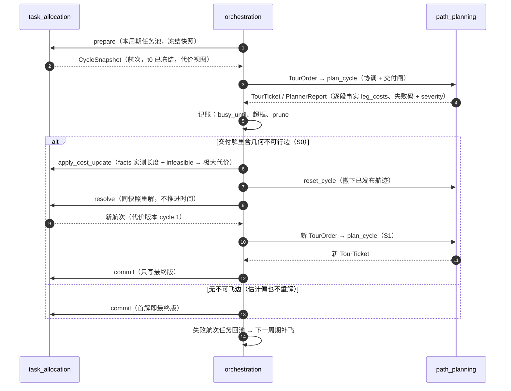

# ExperimentForGraduation

## 项目概述

《多无人机智能调度中的任务分配与航迹规划方法研究》的实验代码。



本文研究城市低空持续任务流下的多机巢多无人机协同调度：上层在一个滚动周期内联合决定"执行哪些任务、由谁执行、按何顺序、回哪个巢"，并在可完成任务必须交付的约束下最小化含返航的三维航程与迟到；下层为每条派出的航次交付带时间的无碰撞轨迹，单机联立优化时空、多机只做几何让路；两层只交换出发时刻、停留点序列和真实用时。

项目把调度拆成两个互不依赖、各自可验收的问题，再用一层只做编排的接口把结果拼起来。

- **第 3 章决定派活**：每个滚动周期选执行集，用选择 + MUAS（DMDE）联合求解指派、顺序与终点机巢；完成是约束，含返航的航程与迟到是成本。
- **第 4 章交付航迹**：给定机号与冻结的出发时刻，单机把位置、速度、加速度、时间步长联立优化到最短飞行时长；多机冻结时刻、只改几何让路——改几何即重解时间。
- **编排层只拼接**：两个求解器互不调用，只交换冻结的出发时刻、停留点序列、真实用时三样东西。逐周期派单—收航次—记账，把下层报出的逐段事实收敛成两类：**几何不可行边**（同周期以极大代价写回、至多重解一次）与**失败航次**（任务回池、下一周期补飞）。不做距离倍率校准。

拆开不是权宜：上层是组合离散、下层是连续非线性，第 3 章不假设轨迹一定飞得出来，第 4 章不假设任务一定派得合理。

**故事的形状：两个各自闭合的小故事，加一个拼接后才出现的大故事。**

1. **第 3 章、第 4 章各自是一个能独立讲完的故事**：问题、方法、实验、验收全部在自己包内闭合——单独 import 零泄漏（TA/PP 互相看不见对方），实验只启动自己的求解器。抽掉其中任何一章，另一章的结论照样成立；
2. **`orchestration/` 是把它们串起来之后才出现的大故事**：两个方法各自成立，不等于拼起来就没有矛盾——上层按垂直切面估航程，下层飞的是绕建筑、受动力学约束的真实轨迹，这个差值不在任何一层内部消化，只能在最外层观测并闭环（失败回池补飞 + 硬不可行剔除）。这些矛盾只有集成层才会暴露，所以大故事不是两个小故事的简单相加；
3. **拼接不改变两个子故事的科学性**：回灌只走 `CostUpdate`（`facts` 实测长度 + `infeasible` 不可飞边）一个外部接口，TA 的求解器与默认代价路径一行不动，PP 只多报一份逐段事实。因此前两章各自独立成立，编排层的实验（`orchestration/experiments/`）是在"两个已被独立验证的方法"之上的增量——即使集成部分被质疑，两章的完整性不受牵连。

三个部分：两份各自独立的方法，外加一层只做编排的集成层。

```text
第 3 章  task_allocation/   协同任务分配（独立求解器，不需要下层）
第 4 章  path_planning/     航迹规划（独立求解器，不需要上层）
         orchestration/     编排层：只经公开接口调用两者，不含算法
```

两个方法互不 import、互不引用；`orchestration/` 是唯一同时看见两者的地方。

---

## 1. 第 3 章：任务分配（`task_allocation/`）

**问题**：任务持续到达、机队供不应求、机队分散在多个机巢、代价是三维地形。每 240 s 一个决策周期（第 3 章实验取 240 s，编排冒烟 `exp01_smoke` 取 1800 s，论文口径 600 s），每周期要回答：

> 本周期执行哪些任务、由哪架机执行、按什么顺序、最后落哪个巢。

**目标口径**：完成是约束，成本是目标。可完成的任务由覆盖门禁构造性强制交付，在这个可行域里最小化含返航的三维航程与迟到惩罚。

**方法三步**：

1. **选择**：从本周期任务池 $T_t$（新到达 ∪ 滞留 ∪ 故障释放）选出执行集 $S$。候选规模与入选规模解耦，入选上限接 $cap(t)$，所以"充电中的机"不会变成幻影容量。
2. **MUAS**：对 $S$ 做离散映射差分进化（DMDE）——指派与访问顺序联合编码，终点机巢在内层分配，返航计入总航程；解码后修复不可行串；再做交付后成本 polish（组内重排 + 跨机改派，只在执行集不减且航程**严格**变好时接受）。
3. **滚动**：写回完成/滞留、机队状态（位置、剩余航程、充电/故障/忙碌），推进下一周期；事件触发（`methods/rolling/event_trigger.py`：机故障 / 紧急任务 / 巢不可用）决定是否提前重规划。

**代价是估计，不是实测**：航段代价取 DEM + 建筑屋顶包络下的垂直切面三维航程，时间窗与 ETA 同源。它不知道下层最终会用哪条真实轨迹——这个差值不在分配层内部消化，而是留给 §4 的外层闭环。

**入口**：`task_allocation/methods/rolling/horizon.py::RollingHorizon.run_cycle`，返回 `CycleRecord`。

**实验**：`experiments/exp01_smoke` … `exp12`。方法正文见 [`Chapter3_README.md`](task_allocation/Chapter3_README.md)。

## 2. 第 4 章：航迹规划（`path_planning/`）

**问题**：上层给定"哪架机、几点起飞、去哪些点"，下层交付**带时间的 trajectory**，不是只有几何的 path——上层要用它算 `busy_until`、做跨周期冲突检测、画真实飞行过程。约束三条：不撞建筑，不撞同期同伴，不撞"上一周期起飞、此刻仍在空中"的自己人。

**两层解耦**：

- 单机上让时空**耦合**：位置、速度、加速度、时间步长联立求解，目标最短飞行时长。理由是纯几何解不出"飞得通且飞得快"的轨迹——转弯半径随速度变（$R_{\min}=v^2/a_{\max}$），同一条窄弯 $v=15$ 过不去、$v=8$ 过得去。
- 多机上让时空**解耦**：出发时刻与速度口径冻结，只改几何，不替上层重排机队（$n$ 机联合是 $O(n^2)$ 条非凸约束，且等于第二个调度器）。
- 两半的接缝是一个原子操作——**改几何即重解时间**。

**流水线**：

1. 走廊 + SDF 距离场给计算域与净空；RRT 出 2–5 条无碰撞折线作初值，不承担最优性；
2. CasADi + IPOPT 对 $\left(x_k,v_k,a_k,\Delta t\right)$ 联合优化，约束含速度与推力上下界、净空、走廊、端点位置与速度；规划速度取 $0.9\,v_{\max}$ 只为给求解器留内部可行域，不是物理上限；
3. 连续冲突检测：轨迹离散成匀速弦、闭式求最近接近点（CPA）；弦近似误差要求判据**膨胀**，宁可误报不可漏检；逐对之前先过"时间分离 / 包围盒分离 / 相对运动下界"三级证书，证书阈值与 CPA 阈值严格互补，中间不留缝；
4. 冲突驱动的局部空间重规划：先试垂直层切换（垂直安全间隔 15 m，代价低），再试横向弧高偏移（端点不动），候选量按净空亏欠取档、命中即停；每个候选都必须走完四步——重解时间、重离散、全对复检、独立验证；
5. 全域交付闸：整条轨迹组装后过 0.2 m 稠密净空 + 全域真几何，不过就返回 `CLEARANCE_VIOLATION` 且**不带航迹**（没有几何可交付，就不给下游一条"看起来像航迹"的东西）。

**新—旧冲突已接线**：`plan_fleet` 在规划前按本批最小 $t_0$ 结算旧航迹，取仍在飞且时间窗重叠的旧航迹一起检测；旧侧用 `movable_ids` 白名单显式冻结（不靠机号大小），协调后只回写新侧。

**入口**：`path_planning/api.py::PathPlanner`——`plan` / `plan_fleet` / `coordinate` / `busy_until` / `prune`，上层只需要这五个。

**实验**：`exp01_smoke`（240 s 周期、两周期四机；周期 2 的新航迹在"周期 1 已发布航迹"约束下规划，新—旧冲突由旧侧冻结消解，逐周期 + 跨周期审计）、`exp07_two_rounds`（单机两航次链式，不接上层决策周期）。方法正文见 [`path_planning/Chapter4_README.md`](path_planning/Chapter4_README.md)。

**边界**：不做三维风场、能耗/功率模型、多机联合优化全部轨迹、CFD。

## 3. 两者为什么各自独立（"两个小故事"的根据）

先看结构：两个求解器之间不直接连线，所有请求与返回都经过 `orchestration`。


图中只画包与包之间的依赖，不画内部算法；回灌的落点与剔除/补飞口径见 §4。

1. **代码层零交叉引用**：`task_allocation` 不 import `path_planning`，反之亦然；两侧也都不 import `orchestration`。这条不是口头约定——`tests/test_module_independence.py` 用 AST 扫全包，出现跨包 import 直接报红。几何与坐标工具是从上层复制的一份自包含副本，为的是任一包都能单独启动、单独测试。副本的一致性由仓库根 `tests/test_geometry_parity.py` 守——这条对拍（逐点比对）必须 import 两侧，所以它放在两个包之外，删掉它两侧照常运行，不构成运行时依赖。
2. **数学形态不同**：上层是组合离散（选择 + 指派 + 顺序 + 终点巢），下层是连续非线性（轨迹与时间剖面的 NLP）。合成一个模型不是"更强"，是既解不动又说不清谁负责。
3. **接口只交换三样东西**：出发时刻 $t_0$、停留点序列、真实用时与真实航程。这几样给定后，两侧都能自洽求解、独立验收。
4. **估计与实测的差留给外层**：这是设计选择，不是缺陷。上层必须先用估计代价才排得出方案，下层必须拿到航次才规划得出真实轨迹。

于是第 3 章不假设"轨迹一定飞得出来"，第 4 章不假设"任务一定派得合理"；两章各自成文、各自实验、各自验收——这是"两个小故事各自闭合"的全部含义。

> 一处必须点明的口径差：上层差分进化比的是**含返航的三维航程**（迟到只作软计价，不是硬约束，也不是差分主项）；下层直接最小化**飞行时长**，同时产出真实航程。回灌时两者用途不同：`path_len_m` 与失败码只用来判"这条边还飞不飞得了"（不改差分结构、不缩放估计）；`duration_s` 只修时间账（迟到、ETA、`busy_until`），不改变差分依据。Lu et al. 回填的是电量/威胁驱动的代价矩阵，与本仓库的可行性回灌不是一回事。

## 4. 完整故事：`orchestration/` 如何把两者拼起来

这一章回答的问题，两个子故事都回答不了：**两个各自成立的方法拼成系统后，估计与实测的差在哪里显现、代价多大、什么时候才值得推倒重来。** 所以它自己的实验（`exp01_smoke`）必须同时启动两个求解器——这正是实验归属表把它单列一层的判据。

**编排的基本形状：一个周期推进一次。** 交换物定义在 `orchestration/protocol.py`：

| 消息 | 方向 | 关键字段 |
| --- | --- | --- |
| `TourOrder` | 上 → 下 | 机号、**冻结的 $t_0$**、起点、`stops`（首项起飞点、末项终点机巢）、`task_ids`、逐点服务时长 |
| `TourTicket` | 下 → 上 | $t_0$ / $t_\text{end}$ / `duration_s` / `path_len_m`、`time_source`（planned / estimate / failed）、失败码 + `failure_severity`、逐段 `leg_costs`、`gate` |
| `PlannerReport` | 下 → 上 | 一批航次 + 让路留痕 `moved` + 冲突前后计数 |
| `CostUpdate` | 上 → 环 → 上 | `facts`（已飞航段实测长度）、`infeasible`（几何不可行边）、`nest_ends`、`source_attempt`、`reason` |
| `CycleSnapshot` / `CyclePlan` / `LoopTrace` | 上 → 环 / 记账 | 周期与区间、执行集、`est_cost`、`snapshot_id`/`attempt`；`busy_until`、`overruns`、`pruned`、`rolled_back`、`assignments`、`attempts`/`n_resolves`/`unresolved_infeasible_edges`/`infeasible_but_survived` |

一次推进五步：

1. 上层 `prepare` 推进一个周期并冻结快照，给出本周期航次（$t_0$ 已冻结）；
2. 适配器把航次转成 `TourOrder`，下层 `plan_cycle` 排一批航迹（含协调与交付闸）；
3. 交付解里若有几何不可行边 → 以极大代价写回、同快照重解一次、再排一版（S1）；
4. 收航次：`planned` 记 `busy_until = t_end`；`failed` 记码、任务回池，**不虚占机位**；
5. `commit` 只写最终版；`prune` 摘掉已落地航迹，并判定超框（$t_\text{end}$ 晚于周期末）——如实上报，不靠"通常不会超"掩盖。

完整闭环按时序展开如下（同周期只重解一次，跨周期靠失败回池补飞）：



三条硬约束（违反任一条，拼接就是假的）：$t_0$ 由上层冻结，下层不擅自改；一个机号同一时刻只有一条未结束航迹，`busy_until` 是跨周期累计值；失败航次不进时长账。

**闭环机制：事实回灌 → 不可行剔除 → 失败回池补飞。** 闭环只在最外层：

1. **回灌**：下层只报事实（`LegCostRecord`：端点、实测长度/时长、`time_source`、失败码 + `severity`），编排层按边写成代价数值——已飞航段用实测长度（同一权重口径 \(c_{ij}=\ell^{real}_{ij}w_j\)），几何不可飞边写成一个极大值。`duration_s` 仍只进时间账（迟到、ETA、`busy_until`），上层时间仍是软约束。
2. **判据**：不看残差，只看一条——`severity=infeasible` 且落在 `INFEASIBLE_CODES` 白名单（走廊过窄/出域、`RRT_NO_PATH`、净空违约、端点出带）。航程/续航超限与求解器偶发失败不写：它们是整条航次的预算判定，写成"这条边不可飞"会误杀可行 OD。
3. **回灌（同周期，至多一次）**：写进极大代价 → 同快照重解 → 只提交最终版；含该边的航次由任务分配内部已有的航程检查判死，不另设第二套闸门。上层估计是排序用的近似尺子，不是模拟器；**不做**倍率校准、不留跨周期缓存、不做跨周期实测覆盖（任务点逐周期变化时"旧 OD 的实测/估计比"不可迁移）。
4. **补飞（跨周期）**：失败航次的承载任务回池（`reopen`），下一周期重新派活；这是闭环的另一半，与剔除各管一段时间尺度。

把"拿上一周期的实测去改下一周期的估计"排除掉是必须的：任务点持续变化时，旧样本的比例改的是一张新矩阵，会把可行 OD 压成不可行、把分配推到两个近优解之间来回跳。同一周期内的实测写回是另一回事——同一批 OD、同一张矩阵，它就是事实。闭环的价值是"别把飞不了的路当成能飞"，不是"把估计器训练准"。

**文献参照**：Lu et al., *Energy-aware joint task assignment and 2D path planning for cooperative multi-UAV networks*, Vehicular Communications 60 (2026) 101021——同样是分层解耦 + 显式接口 + 事件触发的 `update–reassign–replan` 环。它回填的是**代价矩阵的驱动状态**：电量骤降，或移动威胁使威胁度 $D_k$ 变化，从而更新任务–无人机的代价矩阵 $C$；管理器用动态匈牙利改派，无人机重跑 SE-ABC 调整三维航迹。本仓库只参照"何时重排"的形状；差别在于它的分配是扩展匈牙利 + 电量/威胁驱动的代价矩阵改派、轨迹是威胁–能量加权的 SE-ABC 搜索，本仓库的分配是"滚动 + 选择性 + 多机巢"的组合搜索、轨迹是连续 NLP，差分依据是三维航程代价（时间只是软罚），回填不引入能耗模型。

### 4.1 三层的分工与边界

| 层 | 内容 | 边界 |
| --- | --- | --- |
| `task_allocation/` | 选择 + MUAS(DMDE) + 滚动 + 事件触发；`exp01…exp12` | 不排轨迹、不看见下层；代价是估计，真实差值交给编排层 |
| `path_planning/` | 单机联合优化、连续冲突检测、局部让路、全域交付闸、新—旧接线；`exp01_smoke`、`exp07_two_rounds` | 不替上层派活、不重排机队；只对给定航次负责 |
| `orchestration/` | 契约、两个适配器、`LoopDriver` 逐周期驱动、`feedback.py`（不可飞白名单 + 实测长度、回灌单）、单测；`exp01_smoke`（真派活 + 真航迹 + 事实回灌 + 失败回池补飞） | 重排按周期推进（同周期只重解一次）；在飞中改派、按航段/按机的回填粒度、真场闭环（`exp07_closed_loop`）仍在其外 |

## 5. 代码规范（可执行，不只写在文档里）

1. **依赖禁令**：`task_allocation` ✗ `path_planning`、`path_planning` ✗ `task_allocation`；两侧都 ✗ `orchestration`；`orchestration` 可以 import 两侧——那是它唯一的职责。守卫：`tests/test_module_independence.py`（AST 扫全包，包内相对 import 不算违规）。
2. **实验归属：一个实验只验证它所在的那一层。**

   | 目录 | 只验证 | 不能出现 |
   | --- | --- | --- |
   | `task_allocation/experiments/*` | 第 3 章任务分配 | 不排轨迹、不启编排层 |
   | `path_planning/experiments/*` | 第 4 章航迹规划（含它自己的跨周期协调） | 不替上层做分配、不验证系统闭环 |
   | `orchestration/experiments/*` | 整套调度链（派单 → 航迹 → 记账 / 闭环） | 不替代两包各自的实验；闭环冒烟用 `exp01_smoke`（事实回灌 + 失败回池补飞） |

   判据一句话：**一个实验如果必须同时启动两个求解器才能解释它的结论，它就不属于前两个目录。**

3. **数据单一来源**：场景数据只在仓库根 `data/`，两个包只读、不各建副本。上层走 `scenario_data.DATA_ROOT`，下层走 `scenario.data_dir`；换布局只改这两处。守卫同上（`test_data_lives_at_repo_root` 断言 `task_allocation/data`、`path_planning/data` 不存在）。
4. **跨包对拍只能放在仓库根 `tests/`**：几何层逐点对拍（比对）要同时 import 两侧，放进任一包就破了第 1 条；它不构成运行时依赖，删掉两侧照常运行。

数据布局、场景清单与新增场景步骤见 [`data/README.md`](data/README.md)。

## 6. 仓库结构

```text
data/                     两个方法共用的场景数据（只读；见 data/README.md）
  guangzhou/              广州：建筑 shapefile / dem.tif / 3 机巢 / 禁飞区 / region.geojson
  lasa_chengguan/         拉萨城关区：DEM / 6 机巢 / 区界多边形
task_allocation/          第 3 章：滚动周期下的协同任务分配
  methods/                选择 + MUAS(DMDE) + 滚动（含 event_trigger）
  experiments/            exp01…exp12，一个实验一份配置、一份审计
  baselines/ common/      构造式基线、类型与场景
  Chapter3_README.md      方法正文
path_planning/            第 4 章：既有航迹约束下的冲突检测与空间重规划
  api.py                  对外唯一入口
  common/ methods/        领域模型、几何与空间、时间优化、冲突、协调、编排
  methods/planning/delivery_gate.py   全域交付闸
  experiments/            exp01_smoke、exp07_two_rounds
  docs/                   分层架构、模块职责、时间口径、冲突模型
  Chapter4_README.md      第 4 章方法正文（唯一的模块设计说明）
orchestration/            编排层：只经公开接口调用两者，不含算法
  protocol.py             交换物 + 两个端口（Protocol）
  adapters/               PathPlanner → PlannerPort；RollingHorizon → AllocatorPort
  orchestrator.py         LoopDriver：逐周期驱动、超框、失败回池、prune、不可飞边清单
  feedback.py             INFEASIBLE_CODES 白名单 / infeasible_edges_of / flown_legs_of / build_cost_update
  allocators/cyclic.py    CyclicTaskAllocator（定点投放 + 最近空闲机，非生产派活）
  experiments/exp01_smoke/ 真派活 + 真航迹 + 事实回灌 + 失败回池的闭环冒烟（广州全城，3 巢 / 6 机 / 30 任务）
  DESIGN.md               按当前实现重写的设计（契约/时序/两期派活/硬规则）
tests/                    仓库级跨包测试（几何层对拍 + 模块边界守卫）
paper/                    论文稿
```

## 7. 跑法

```powershell
uv sync
$env:PYTHONPATH="."          # 两包都按仓库根解析 data/ 与自身模块
$PY=".\.venv\Scripts\python.exe"

# 第 3 章（任务分配）
& $PY -m pytest task_allocation/tests -q
& $PY task_allocation/experiments/exp01_smoke/run.py --seeds 42 42 44

# 第 4 章（航迹规划）：实验用相对导入，必须 -m 方式跑
& $PY -m pytest path_planning/tests -q
& $PY -m path_planning.experiments.exp01_smoke.run --seed 42
& $PY -m path_planning.experiments.exp07_two_rounds.run

# 编排层（假端口，不建场）
& $PY -m unittest orchestration.tests.test_orchestrator orchestration.tests.test_adapters orchestration.tests.test_cyclic_allocator

# 编排层冒烟（真派活 + 真航迹，广州全城；结果写 orchestration/experiments/exp01_smoke/results/seed_0）
& $PY -m orchestration.experiments.exp01_smoke.run

# 仓库级：模块边界 + 数据布局 + 几何层对拍
& $PY -m pytest tests -q
```

实验口径见各 `experiments/*/notes.md`。`orchestration/experiments/exp01_smoke` 不另设说明文档：任务与机队口径在 `config.yaml` / `tasks.json`（`generation` 段带抽样与过滤的 provenance，上层求解预算与种子在 `solver` 段 + `experiment.seed`），模块职责写在各文件 docstring，跑法与落盘见 `results/README.md`，判据在 `support/audit.py`。
